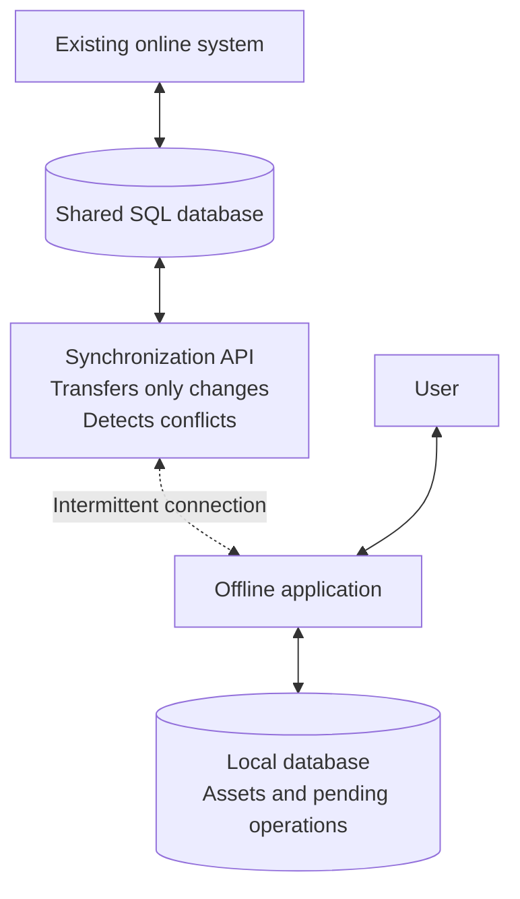

# Paginated Todo List

An AngularJS application backed by an ASP.NET Web API 2 service targeting .NET Framework 4.6.

## Changes implemented

- Added a reusable pagination directive with page sizes of 10, 20 (default), 30, or all items.
- Implemented first, previous, next, last, and direct page navigation, with page and item totals.
- Added server-side sorting by ID, task, or creation date. Changing the sort resets the page while preserving the selected page size.
- Introduced a paginated API response with items and metadata, parameter validation, and service-layer pagination logic.
- Added loading indicators, error handling, retry support, and protection against outdated responses.
- Added five service tests and JavaScript checks for pagination and sorting behavior.

## Run locally

Open `InterviewTestPagination.sln` in Visual Studio 2019 with ASP.NET web development tools and .NET Framework 4.6 targeting support. Restore NuGet packages and run `InterviewTestPagination` using IIS Express.

The application uses 55 sample tasks stored in memory; no database is required.

---

## Architecture proposal: Offline asset management

This separate design exercise describes a proposed offline system; it is not part of the pagination implementation above.

The challenge is to let users manage assets without connectivity and synchronize with an existing online system through its shared SQL database. The online application remains unchanged.

- **Offline work:** After an initial download, the application reads and writes locally, saving each change and its pending operation in one local transaction.
- **Synchronization:** When connected, it uploads pending operations and downloads changes in batches using a persisted cursor, reducing bandwidth and allowing interrupted transfers to resume. Unique operation IDs prevent duplicate processing on retries.
- **Conflicts:** Updates and deletes compare the original `rowstamp` with the current database value atomically. Conflicting changes are preserved for the user to resolve. New assets use temporary local IDs mapped to server-generated IDs after synchronization.
- **Change tracking:** Assuming database-level extensions are allowed, CDC or triggers capture changes from both systems, including deletions. The initial snapshot must be paired with a consistent cursor so subsequent changes are not missed.
- **Scalability:** Stateless API instances can scale horizontally; indexed change tracking, bounded batches, and compressed responses limit database load and network traffic.
